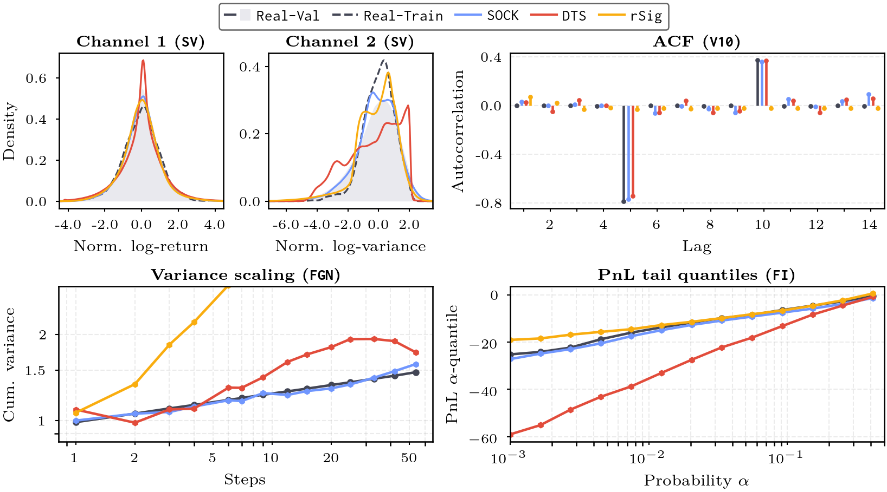

# Generating Financial Time Series by Matching Random Convolutional Features

[](https://arxiv.org/abs/2606.05138)

**Accepted to NeurIPS 2026.**

**TL;DR:**
- We introduce a simple technique for training time-series generative models from limited data (single historical path!).
- We train generative models by matching random convolutional feature statistics. This is inspired by the success of [ROCKET](https://arxiv.org/abs/1910.13051) and [HYDRA](https://doi.org/10.1007/s10618-023-00939-3) in time series classification.
- This repo provides a simplified version of the paper code, designed to be easy to get running.

***

**Properties of generated time series**

<p align="center">
  
</p>


## Quick usage

For walkthroughs, see the [generation](example_notebooks/generation_example.ipynb) and [classification](example_notebooks/classification_example.ipynb) example notebooks.

For training from the command line, run:

```bash
# first we need to generate a synthetic dataset (here: TGH, seed 0)
uv run --no-sync python scripts/sim.py 0 configs/varp_tgh.yaml

# train a generative model
uv run --no-sync python scripts/train.py --dataset varp_tgh --dataset-id 0 --opt-steps 1000

# or with logging to wandb
uv run --no-sync python scripts/train.py --dataset varp_tgh --dataset-id 0 --opt-steps 1000 --wandb-project sock
```

***

## Data

In the paper, we study the limited-data setting where the training data consists of a single path of length $H$.

We consider two types of datasets:
- *synthetic datasets:* we train on a single path and evaluate on $J$ independent continuations.
- *real datasets:* we observe a single out-of-sample trajectory, so evaluation also uses a single path.


### Synthetic datasets

Use [`scripts/sim.py`](scripts/sim.py) to generate the synthetic datasets `V1`, `V10`, `TGH`, and `SV`. Each is defined in [`configs`](configs/).

Example usage:

```bash
# generate the VAR(1) dataset; seed 0
uv run --no-sync python scripts/sim.py 0 configs/var1_01.yaml
```

This writes the file: 
`data/<dataset_name>/<dataset_name>_<seed>.pt`.

This is a dict containing two pytorch tensors:
```python
{
    # H is length of data path; J is number of parallel out of sample trajectories
    "train/path": torch.Tensor,  # shape [H, d]
    "val/paths": torch.Tensor,   # shape [J, H, d]
}
```
with keys `train/path` and `val/paths`.

### Real datasets

See [`scripts/prepare_custom_dataset.py`](scripts/prepare_custom_dataset.py) for minimal real and synthetic dataset examples. Real-data preparation details are in the paper.

### Using your own datasets

[`scripts/train.py`](scripts/train.py) expects real data at: `data/<dataset_name>/<dataset_name>.pt`

Depending on what value for `dataset-type` is passed to [`scripts/train.py`](scripts/train.py), the `.pt` file should have the following shape:
```python
# if you pass: dataset-type synth
# then train.py expects a synthetic dataset and expects multiple val paths
{
    "train/path": torch.Tensor,  # shape [H, d]
    "val/paths": torch.Tensor,    # shape [J, H, d]
}

# if you pass: dataset-type real
# then train.py expects a real dataset that only contains a single out-of-sample path
{
    "train/path": torch.Tensor,  # shape [H, d]
    "val/path": torch.Tensor,    # shape [ H, d]
}
```

Example to create your own real dataset:

```bash
# create minimal custom examples (both synth + real formats):
uv run --no-sync python scripts/prepare_custom_dataset.py

# train a generator on it:
uv run --no-sync python scripts/train.py --dataset custom_real_example --dataset-type real
```

## A full training run

All the default configs of [`scripts/train.py`](scripts/train.py) were used for the runs reported in the paper.
To reproduce performance on e.g., seed 0 of the `TGH` dataset, simply run:

```
uv run --no-sync python scripts/train.py --dataset varp_tgh --dataset-id 0 --wandb-project sock
```

## Citation

If you use this code, please cite the paper:

```bibtex
@misc{mueller2026generatingfinancialtimeseries,
  title={Generating Financial Time Series by Matching Random Convolutional Features},
  author={Konrad J. Mueller and Nikita Zozoulenko and Ben Wood and Thomas Cass and Lukas Gonon},
  year={2026},
  eprint={2606.05138},
  archivePrefix={arXiv},
  primaryClass={cs.LG},
  url={https://arxiv.org/abs/2606.05138}
}
```
